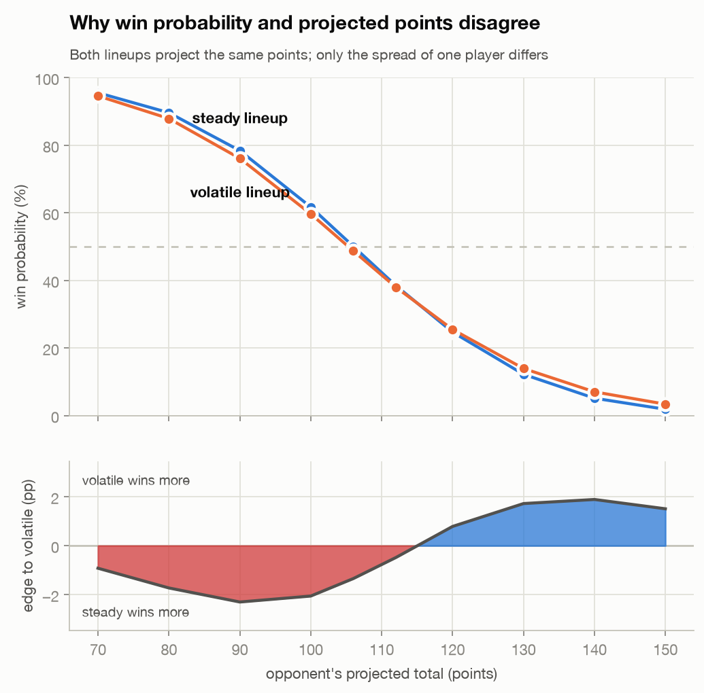
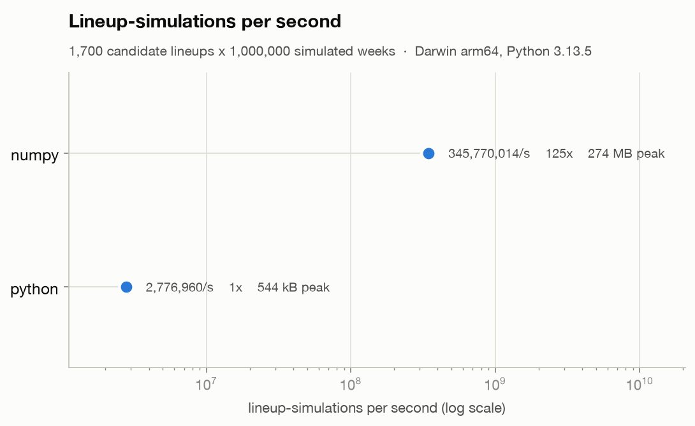
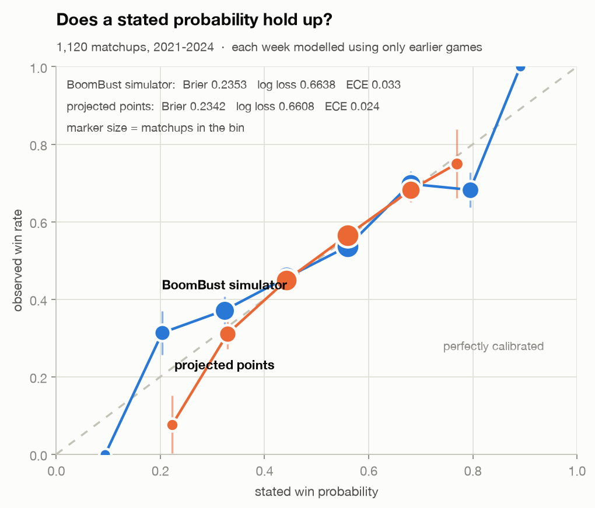

# BoomBust

A fantasy football lineup optimiser that ranks lineups by **how often they win your matchup**, not by how many points they project.

Those are not the same question, and the difference is the whole point. ESPN tells you a lineup projects 123.4 points. It cannot tell you that if you are a 12% underdog this week, a *worse-projecting* lineup wins more often — because you do not need a good week, you need a big one.

```
$ boombust lineup --week 10 --team 1

Boom or Bust  vs  Prior Beliefs   BoomBust Synthetic 2024, 2024 week 10
1,700 legal lineups · 1,000,000 simulated weeks · numpy backend · 4.97s

  best lineup — 55.9% to win
  slot   player                       proj      10th–90th  note
  QB     Josh Allen                   18.4   11.0–27.5    vs IND
  RB     D'Andre Swift                14.5    6.5–24.4    vs NE
  RB     Kareem Hunt                  13.9    5.9–24.0    vs DEN  (+14% matchup)
  WR     CeeDee Lamb                  21.0    8.6–36.7    vs PHI  (+18% matchup)
  WR     Cooper Kupp                  14.8    6.6–24.9    vs MIA
  TE     Sam LaPorta                   7.7    2.8–14.1    vs HOU
  K      Brandon Aubrey                9.0    4.8–14.1    vs PHI  (-6% matchup)
  D/ST   ARI D/ST                      5.5    0.0–11.8    vs NYJ
  FLEX   Christian McCaffrey          18.6    9.3–30.0    vs TB
         total                       123.4      opponent 118.7 ± 23.0

  top 5 lineups
    #   P(win)    proj     sd  differences from the best lineup
    1   55.88%   123.4   23.6  —
    2   52.87%   121.3   24.6  +Joshua Dobbs  -Josh Allen
    3   52.72%   120.9   23.4  +Chigoziem Okonkwo  -Sam LaPorta

  what each decision is worth
  the swing between forcing a player into the lineup and forcing them out
  player                       win prob    points  verdict
  CeeDee Lamb                   +17.74pp    +14.1  start
  Amari Cooper                  -17.54pp    -13.9  bench
  DK Metcalf                    -17.54pp    -13.9  bench
```

---

## The idea

You win a head-to-head matchup by **clearing your opponent's total**, not by averaging well. That makes the right amount of risk depend on who you are playing.

The chart below holds everything constant except one slot, filled by either a steady player (10 points, σ 3) or a volatile one (10 points, σ 11). *Both lineups project exactly the same points.* The only thing that changes is who the opponent is.

<picture>
  <source media="(prefers-color-scheme: dark)" srcset="docs/img/risk_tilt-dark.png">
  
</picture>

| opponent projects | steady lineup | volatile lineup | edge to volatile |
|---|---|---|---|
| 90 pts (you're a big favourite) | 78.5% | 76.2% | **−2.30pp** |
| 106 pts (coin flip) | 50.1% | 48.8% | −1.34pp |
| 130 pts (big underdog) | 12.2% | 14.0% | **+1.71pp** |
| 140 pts (hopeless) | 5.2% | 7.0% | **+1.88pp** |

Against a 140-point opponent, swapping in the volatile player raises your chances by more than a third — for zero projected points. Against a weak opponent the same swap costs you. A projection system cannot express this, because both lineups have the same projection. A simulator gets it for free.

The crossover sits near 35%, not 50%, because fantasy scoring is right-skewed: extra variance buys a bigger upside than it costs on the downside.

---

## Quick start

```bash
python -m venv .venv && source .venv/bin/activate
pip install -e .
```

Build a database from real NFL data and a league to play with — no ESPN account needed:

```bash
boombust init
boombust ingest --seasons 2021-2024
boombust synth --season 2024
boombust lineup --week 10 --team 1
```

The synthetic league drafts **real players** on their real prior-season production and plays a real schedule; every stat line and every outcome comes from nflverse. Only the league is invented. That is what makes the whole pipeline runnable and testable without anyone's credentials.

To point it at your own ESPN league, copy `.env.example` to `.env` and fill in your league id (plus the `espn_s2` and `SWID` cookies if the league is private):

```bash
boombust sync --weeks 1-18
boombust lineup --week 10
```

---

## How it works

### 1. Data

Weekly player and team stat lines come from [nflverse](https://github.com/nflverse/nflverse-data), one parquet per season, cached on disk. Available seasons are discovered from the release listing rather than hardcoded. Everything lands in one SQLite file.

**Raw stat lines are stored, never points.** Scoring rules are applied at read time, so a single ingest serves standard, half-PPR, PPR, or whatever your league has configured. ESPN's `scoringItems` are translated into the same canonical stat names, and any stat id the model does not know about is reported rather than silently scored as zero.

### 2. Score model

Each player becomes three numbers:

| | |
|---|---|
| `p_active` | probability they post a real score at all |
| `ln_mu`, `ln_sigma` | log-normal location and scale of the "they played" component |

A log-normal is the right shape for fantasy scoring: non-negative, right-skewed, the occasional enormous week. The spike at zero — inactive, benched, a goose egg — is a **separate Bernoulli**, because folding it into one bell curve understates both the duds and the ceilings, and the ceiling is exactly what an underdog is shopping for.

The parameters are fitted from each player's last 10 games, exponentially weighted with a 4-game half-life, shrunk toward a positional prior so one huge game does not make someone a 40-point-a-week player. The result is then scaled by how much the week's opponent gives up to that position, relative to the league — itself shrunk toward neutral and clamped to ±25%, so one quiet game against a defence proves nothing.

Injured and bye-week players get `p_active = 0`, a hard zero. `QUESTIONABLE` lowers the chance of playing without changing the distribution of what happens if they do.

### 3. Simulator

Every legal lineup is enumerated first. A lineup's score depends only on *who* starts, not which slot each one fills, so the unit is the **set of starters that admits at least one valid slot assignment** — two ways of slotting the same nine players are one lineup. Interchangeable slots are pruned during the walk and the rest is deduplicated. A 17-man roster with 9 starting slots yields about 1,700 distinct lineups. (Cross-checked against exhaustive subset search in the tests.)

Then, for a million simulated weeks: draw a score for every player, total each candidate lineup, compare against the opponent's total, count the wins.

```
       draws        (P players × S sims)
         ↓
    lineup totals   (L lineups × S sims)      ← the expensive part
         ↓
    wins per lineup (L,)
```

Three backends compute this, chosen at runtime with `--backend`:

**`numpy`** — the reference. The lineup totals are a matrix multiply: an (L, P) 0/1 membership matrix against the (P, S) draws. Runs anywhere; every other backend is checked against it.

**`cupy`** — a near line-for-line port to the GPU. `cp` for `np`.

**`cuda`** — a hand-written kernel ([`kernels/boombust.cu`](kernels/boombust.cu)) launched through CuPy's `RawKernel`.

CuPy is imported **inside** the GPU backends, never at module scope — it does not install on macOS, and a top-level import would break the NumPy path on the machine most of this was written on.

### 4. Validation

Past weeks are replayed with the model rebuilt from only the games played *before* each week, both sides given the lineup a normal manager would set, and the stated probability checked against what actually happened. See [Does it work?](#does-it-work) below.

---

## The memory problem, and what the kernel does about it

At 1,700 lineups and a million simulations, the lineup-totals array is **6.8 GB** in float32. The array backends cannot hold that, so they chunk over simulations and trade speed for memory.

The custom kernel never builds it. One block owns a tile of simulations:

1. generate every player's score for that tile straight into shared memory,
2. reduce the opponent's starters to one total per simulation — their individual draws live and die in registers and never reach memory,
3. each thread sweeps a stripe of candidate lineups and tallies wins **in registers**, with one `atomicAdd` at the end.

Device memory becomes **O(L + P)** — a few hundred kilobytes, whatever the simulation count — instead of O(L × S). Draws are never written to global memory at all.

That works because randomness is **counter-based**: instead of carrying generator state, the kernel hashes the coordinates of the draw it wants.

```
value = f(seed, player, simulation)
```

Any thread can produce any draw, with no state, no setup and no memory. It also means a block of simulations is reproducible on its own, so chunking the work differently — or spreading it over a CUDA grid — cannot change the answer. (There is a test for exactly that.)

### Testing a CUDA kernel with no GPU

`kernels/boombust.cu` is ordinary C++ once the CUDA keywords are defined away. The test suite compiles **the real kernel source, verbatim** with the system C++ compiler, mapping `__global__`, `threadIdx`, `__syncthreads` and `atomicAdd` onto host equivalents — `std::barrier` and `std::atomic_ref`, so a multi-threaded launch really is concurrent — and drives it through `ctypes`.

Because the NumPy reference implements the same counter-based generator, agreement is expected to be **exact**, and it is:

```
kernel total wins 304,691   numpy total wins 304,691
max |win count difference| : 0
threads 1 vs 64 identical  : True
tile 16 vs 64 identical    : True
```

This exercises the kernel's indexing, shared-memory layout, RNG, tallying, barrier and atomics. It says nothing about warp behaviour, occupancy or real device memory — those need a GPU.

---

## Benchmark

<picture>
  <source media="(prefers-color-scheme: dark)" srcset="docs/img/benchmark-dark.png">
  
</picture>

One *lineup-simulation* = sum one candidate lineup's starters for one simulated week and compare it to the opponent. A week with 1,700 lineups and a million simulations is 1.7 billion of them.

| backend | lineup-sims/sec | vs pure Python | peak memory |
|---|---|---|---|
| `python` (nested loops) | 2,776,960 | 1× | — |
| `numpy` | 345,770,014 | **125×** | 274 MB |
| `cupy` | *needs CUDA* | | |
| `cuda` | *needs CUDA* | | |

Measured on an Apple M4. **The GPU rows are blank because this machine has no NVIDIA GPU** — CuPy does not install on macOS. The backends are written, the kernel is tested for correctness against the reference (above), but any speedup number for them would be invented, so there is none here. On a CUDA machine:

```bash
pip install -e ".[gpu]"
boombust backends                      # confirm they are visible
boombust benchmark --chart docs/img/benchmark.png
```

---

## Does it work?

1,120 matchups across 2021–2024 were replayed, each week modelled using only games played before it.

<picture>
  <source media="(prefers-color-scheme: dark)" srcset="docs/img/calibration-dark.png">
  
</picture>

| forecaster | Brier ↓ | log loss ↓ | ECE ↓ | accuracy ↑ | sharpness ↑ |
|---|---|---|---|---|---|
| BoomBust simulator | 0.2353 | 0.6638 | 0.033 | 0.609 | 0.139 |
| projected-points baseline | 0.2342 | 0.6608 | 0.024 | 0.606 | 0.103 |
| always 50% | 0.2500 | 0.6931 | 0.021 | 0.521 | 0.000 |

**What this shows.** The probabilities are well calibrated: when the simulator says 68%, that side wins 70% of the time. It beats a coin flip by a Brier skill score of **+0.059**.

**What it does not show.** It does **not** beat the projected-points baseline — skill score **−0.004**, a dead heat. That baseline takes the projected margin and maps it to a probability with a logistic fitted on these very outcomes, and it turns out to carry nearly the same information.

That is the honest result, and it makes sense: a lineup's win probability is mostly a monotone function of its projected margin, so a well-fitted curve over the margin gets most of the way there. Two things the simulator still has:

- it is calibrated **with nothing fitted** — the baseline needed 1,120 historical outcomes to learn its slope, while the simulator reads it off the distributions;
- it is **sharper** at equal calibration (0.139 vs 0.103), meaning it commits further from 50%;
- and the baseline **cannot rank lineups at all**. It maps one margin to one probability. Choosing between 1,700 lineups on anything other than projected points is not a thing it can do.

One bin is a genuine miss rather than noise: of the 107 matchups where the simulator said about 79%, only 68% won. That is roughly 2.5 standard errors of overconfidence at the favoured end, and it is the clearest thing to go after next — most likely by letting lineup variance rise, since independent player draws (see [Limitations](#limitations)) make a favourite's total look steadier than it is. The thinnest bins at either end hold four matchups each; marker size on the chart is the bin count, so those read as the noise they are.

### Did the lineup choice actually win more games?

Calibration is not the question that matters in practice. This one is: if you *act* on the win probabilities, do you win more? `boombust decide` replays every team's lineup decision, picks a lineup both ways, and scores both against what the opponent really put up.

```bash
boombust decide --seasons 2021-2024
```

**2,240 decisions across 2021–2024. The answer is no — and the sample is far too small to have said yes.**

| | |
|---|---|
| the two rules picked the same lineup | 92.1% of the time (177 disagreements) |
| of those 177, the result actually changed in | **20** |
| of those 20, win-probability pick won | **5** |
| points pick won | **15** |
| net | **−10 wins** (two-sided binomial p ≈ 0.04) |

Before reading that as a refutation, note the scale. The average disagreement claimed an edge of **+0.16 percentage points**. Over 177 disagreements that is an expected gain of **+0.28 wins** — against a measurement noise floor of **±4.4 wins**. The effect being tested is roughly 16× smaller than the noise, so this backtest could never have confirmed it. What it can say is that there is no evidence of a benefit, and the sign went the wrong way.

Two things stop it being pure noise:

**The mechanism fires exactly where theory says it should.** Disagreements cluster in lopsided matchups and nearly vanish in even ones:

| matchup | decisions | rules disagreed |
|---|---|---|
| heavy underdog (<25%) | 181 | **16.6%** |
| underdog | 467 | 7.7% |
| even (40–60%) | 941 | **4.3%** |
| favoured | 471 | 10.8% |
| heavy favourite (>75%) | 180 | 11.1% |

**The losses are concentrated on one side.** Of the −10 net wins, **−9 came from matchups where the simulator was favoured** and therefore chose the *safer* lineup (−2.6σ); the underdog cases were a wash (−1 win, −0.4σ). That lines up with the calibration miss above, where the simulator was overconfident precisely at the favoured end. Both point at the same cause: independent player draws (see [Limitations](#limitations)) make a lineup's total look steadier than it is, so the model both overstates a favourite's chances and over-rewards playing safe to protect them.

So the fair summary of the whole project: **the probabilities are well calibrated, the ranking is principled, the risk mechanism is real and measurable in isolation — and at real-roster scale it is too small to have shown up as wins, with what signal there is pointing the wrong way.** Fixing the correlation gap is the obvious next move, and it is the same fix both findings ask for.

The full run is in [`docs/decisions.csv.gz`](docs/decisions.csv.gz) (one row per decision) with the summary in [`docs/decisions.json`](docs/decisions.json), so none of this has to be taken on trust.

## Limitations

- **Players are drawn independently.** In reality a quarterback and his own receiver are strongly correlated, and both are correlated with the game's total. This makes every lineup's total look steadier than it is. It is the single biggest modelling gap, and both negative findings above — overconfidence at the favoured end of the calibration curve, and losses concentrated in favoured matchups where the model chose safety — are what you would expect it to cause.
- **Validation uses synthetic leagues.** The players, stat lines, schedules and outcomes are real; the rosters are drafted by the tool. Four independently-drafted leagues per season were used to widen the sample, which means the 1,120 matchups are not fully independent — they share underlying player-weeks.
- **The opponent is assumed to set their projected-best lineup.** `--opponent-lineup actual` uses what they really started, where that is known.
- **Defensive adjustment is positional and coarse** — points allowed to a position, shrunk and clamped. No scheme, no pace, no weather, no Vegas lines.
- **GPU backends are unbenchmarked**, for the reason given above.
- **In-season data depends on nflverse publishing it.** `boombust ingest --list` shows what is actually available.

---

## Commands

| command | what it does |
|---|---|
| `boombust init` | create the database |
| `boombust ingest --seasons 2021-2024` | download nflverse weekly data (`--list` to see what exists) |
| `boombust synth --season 2024` | draft a league from real players |
| `boombust sync --weeks 1-18` | pull a real ESPN league |
| `boombust lineup --week 10` | rank your lineups by win probability |
| `boombust backends` | what can run on this machine |
| `boombust benchmark --chart out.png` | compare the backends |
| `boombust backtest --chart out.png` | replay past weeks, check calibration |
| `boombust decide` | did the win-probability pick win more? |

## Layout

```
boombust/
  config.py            environment and paths
  db.py                SQLite schema
  bench.py             backend benchmark, incl. a pure-Python baseline
  viz.py               charts (light and dark variants)
  cli.py               command line interface
  data/
    nflverse.py        download and ingest weekly stat lines
    espn.py            read-only ESPN league client
    synthetic.py       draft a league from real players
    match.py           ESPN names -> nflverse player ids
  model/
    scoring.py         scoring rules, ESPN stat ids, lineup slots
    projections.py     per-player score distributions
  sim/
    lineups.py         enumerate every legal lineup
    rng.py             counter-based RNG (NumPy side)
    engine.py          roster in, ranked lineups out
    backends/          numpy / cupy / cuda
  validate/
    backtest.py        replay past weeks
    calibration.py     Brier, log loss, ECE, reliability
kernels/boombust.cu    the CUDA kernel
scripts/make_charts.py regenerate every README figure
docs/                  benchmark, calibration and decision results
tests/                 70 tests, incl. the CPU-compiled CUDA kernel
```

## Tests

```bash
pip install -e ".[dev]"
pytest -q
```

No network and no GPU required. The CUDA kernel tests skip automatically if no C++ compiler is on `PATH`.

Worth a look:

- `tests/test_cuda_kernel.py` — the real `.cu` source compiled for the CPU and checked against the NumPy reference, exactly.
- `tests/test_risk_tilt.py` — the project's central claim, proved by holding projected points fixed and varying only the spread.
- `tests/test_lineups.py` — the fast enumerator cross-checked against exhaustive subset search.
- `tests/test_pipeline.py` — stat lines in, ranked lineups out, on a fabricated database.

## Data

Stat lines from [nflverse](https://github.com/nflverse/nflverse-data) (CC BY 4.0). League data from ESPN's public fantasy API, read-only. Neither is redistributed here.
